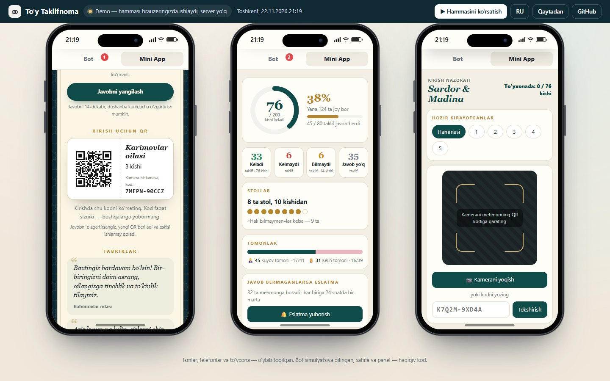
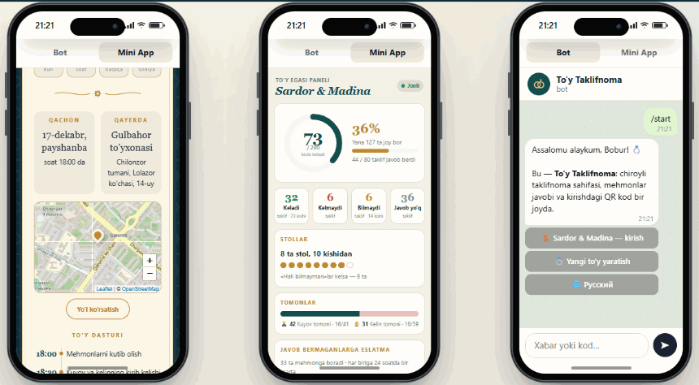
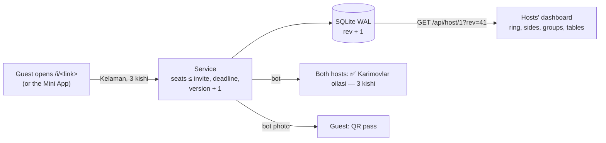

# To'y Taklifnoma

**English** · [O'zbekcha](README.uz.md)

[](https://github.com/xoliddev/toy-taklifnoma/actions/workflows/ci.yml)
[](https://xoliddev.github.io/toy-taklifnoma/)
[](LICENSE)


"To'y taklifnoma" means *a wedding invitation*. This is a **website + Telegram bot**: every family gets a beautiful
personal invitation page (it also opens as a Telegram Mini App), answers *Kelaman / Kelolmayman / Hali bilmayman*,
and gets a signed QR pass for the door. The hosts watch the guest count **live**.

**The wow moment — the hosts see the guest count move.** The moment a family answers "Kelaman, 3 kishi", the hosts'
ring fills, the counter jumps by three, both sides and every group update, the tables estimate changes, and the bot
pings both hosts. On the wedding day the door checker scans the QR: ✅ *"Karimovlar oilasi — 3 kishi"*, a second scan
says ⚠️ *"Bu QR allaqachon ishlatilgan (17:42)"*, a forged one ❌ *"Soxta yoki bekor qilingan QR"*.

**[Live demo →](https://xoliddev.github.io/toy-taklifnoma/)** three phones side by side (the guest, the host, the
door checker), a simulated bot and the real page code, plus the
**[full-page invitation](https://xoliddev.github.io/toy-taklifnoma/demo/invite.html)**. Everything runs in your browser.



<p align="center"></p>

## Features

- **An invitation that looks like one.** Names in a large serif, a live countdown in Tashkent time, the venue on a
  Leaflet map with a "Yo'l ko'rsatish" (directions) button, the program (18:00 kutib olish, 19:00 bazm…), the dress
  code, a personal greeting ("Hurmatli Karimovlar oilasi!") and the wall of approved wishes.
- **Three looks, all drawn in code.** *Milliy naqsh* (an eight-pointed girih star lattice, like Samarkand tiles),
  *Oq-oltin* (minimal white and gold with an art-deco fan) and *Gulli bahor* (blossoms and leaves). No stock images.
- **The envelope.** The page opens as a sealed envelope addressed to the family; a tap breaks the wax seal, the flap
  swings open and the card rises out. `prefers-reduced-motion` skips the animation.
- **Music without copyright.** A gentle original waltz synthesised with WebAudio (no recording, no download), **off
  by default** with a clear toggle; the host can choose *musiqasiz* and the button disappears.
- **RSVP.** Kelaman / Kelolmayman / Hali bilmayman, how many people (up to the invite's seats, enforced on the
  server), a note and a wish. Answers can change until the host's deadline. Wishes appear only after a host approves.
- **The hosts' live dashboard** (Mini App + bot summary): coming / not coming / maybe / unanswered, people against the
  hall capacity on a progress ring, kuyov and kelin sides, every group, how many tables at 10 per table, the latest
  answers, "javob bermaganlarga eslatma" (remind those who have not answered — each guest at most once per 24 hours),
  a message to everyone coming ("to'yxona o'zgardi"), the look and music, and the final list as CSV.
- **QR entry.** Every "Kelaman" gets a personal pass: in the bot as a picture and on the page as a ticket. The QR
  carries an HMAC-signed token (wedding, invite, people, version) — not guessable and not editable. Changing the
  answer bumps the version, so an old QR stops working. A 10-character code is printed under it for phones without
  a working camera. **Partial arrival**: "2 of 3 now, 1 later".
- **The door.** The checker's screen uses the camera through `BarcodeDetector` where the browser has it, with manual
  code entry everywhere. Check-in is atomic: two doors scanning the same pass at once let it in once.
- **Hosts' tools in the bot.** Create a wedding in six questions, add invites one by one or from a **CSV file**,
  personal links (128-bit), a co-host link for the other side, a checker link, approve/hide wishes, reminders,
  broadcast, export. Buttons only: `/start` (and its deep links) is the only command; every screen has "⬅️ Orqaga".
- **Uzbek by default, Russian with one tap** — on the page, in the Mini App and in the bot.

All people, phones and venues are **fictional**. The seeded wedding (80 invites) is 25 days after "today", so the demo
works on any date, also across New Year.

## How it works



```mermaid
sequenceDiagram
    participant S as Server (QR_SECRET)
    participant G as Guest's phone
    participant C as Door checker
    participant DB as SQLite
    S->>G: TT1.1.7.3.2.<HMAC-SHA256, 128 bits> as a QR + code 7MFPN-90CCZ
    C->>S: scanned text (+ how many walk in now)
    S->>S: HMAC ok? this wedding? current version and head count?
    S->>DB: BEGIN IMMEDIATE; UPDATE invites SET checked_in = checked_in + n WHERE id = 7 AND version = 2 AND checked_in + n <= people
    DB-->>S: 1 row → ✅ "Karimovlar oilasi — 3 kishi"  ·  0 left → ⚠️ "allaqachon ishlatilgan (17:42)"
    S-->>C: forged or old version → ❌ "Soxta yoki bekor qilingan QR"
```

The **pure core** (`toytaklif/core/`) has no I/O: the Tashkent calendar and countdown, the signed pass and short code,
a QR encoder (byte mode, level M, versions 1–10, written out here — no third-party QR code), the RSVP rules, the live
numbers, the CSV guest list and the seed. It is ported line by line to JavaScript (`shared/*.js`, including a small
synchronous SHA-256/HMAC), and **shared test vectors** (`shared/test_vectors.json`, made by
`scripts/make_vectors.py`) are checked by both pytest and `node --test` — the same signatures, the same QR matrices,
the same dashboards and texts in Uzbek and Russian. The demo's door even *reads* the guest's on-screen QR back, module
by module, with `shared/qr-read.js`.

## Run it on Windows in 10 minutes

Install Python 3.12 or newer from [python.org](https://www.python.org/downloads/) (tick **"Add python.exe to PATH"**).

1. **Create a bot.** In Telegram open [@BotFather](https://t.me/BotFather), send `/newbot`, pick a name and a
   username ending in `bot`. Copy the token.
2. **Get the code.** Download the ZIP and unpack it (or `git clone https://github.com/xoliddev/toy-taklifnoma`).
   Open PowerShell in that folder.
3. **Settings.** Copy the example, then paste your token and a random `QR_SECRET` into `.env`:
   ```powershell
   Copy-Item .env.example .env
   py -c "import secrets; print(secrets.token_urlsafe(32))"   # paste the result as QR_SECRET
   notepad .env
   ```
4. **Install and run.**
   ```powershell
   py -m venv .venv
   .venv\Scripts\Activate.ps1
   pip install -r requirements.txt
   python -m toytaklif
   ```
   Open your bot and press **Start**. With `SEED_DEMO=1` the fictional wedding is there; press **💍 Yangi to'y
   yaratish** to make your own.

### Open the invitation website and the Mini App

Telegram opens Mini Apps only over HTTPS. On your own computer the easiest free way is a Cloudflare tunnel:

```powershell
winget install --id Cloudflare.cloudflared
cloudflared tunnel --url http://localhost:8080
```

Put the printed address into `.env` as `PUBLIC_URL=https://something.trycloudflare.com` and restart. Invitation links
become `https://…/i/<link>`; the dashboard and the door open from the bot's buttons.

### Or with Docker

```powershell
Copy-Item .env.example .env   # then fill BOT_TOKEN and QR_SECRET
docker compose up -d --build
```

The container runs as a non-root user on a read-only file system with all capabilities dropped; the database lives
in the `toytaklif-data` volume.

## Settings (`.env`)

| Variable | Default | What it does |
|---|---|---|
| `BOT_TOKEN` | — (required) | Token from @BotFather |
| `QR_SECRET` | — (required, 32+ chars) | Signs every QR pass; changing it voids all passes |
| `PUBLIC_URL` | empty | HTTPS address of this server (invitation links and the Mini App) |
| `ADMIN_IDS` | empty | Telegram ids of admins (can close a wedding) |
| `DB_PATH` | `data/toytaklif.db` | SQLite file (WAL mode) |
| `SEED_DEMO` | `1` | Fill an empty database with the fictional wedding |
| `HOST` / `PORT` | `0.0.0.0` / `8080` | Web server |
| `INITDATA_MAX_AGE` | `3600` | Mini App login data older than this (seconds) is refused |
| `RATE_PER_MINUTE` | `30` | Bot buttons and Mini App calls per user per minute |
| `PUBLIC_RATE_PER_MINUTE` | `40` | Invitation page requests per IP per minute |
| `TRUST_PROXY` | `0` | Use `X-Forwarded-For` for the per-IP limit (only behind your own proxy) |

## Security

- **Invite links are bearer keys:** 128 random bits, looked up by their SHA-256 and compared with
  `hmac.compare_digest`. A wrong, unknown or closed link is always the same 404 (page and API); per-IP rate limits
  stop guessing. Pages are `noindex`, `no-referrer`, `no-store`.
- **Mini App calls** carry Telegram `initData`; the server checks the HMAC with the bot token and refuses data older
  than `INITDATA_MAX_AGE` (or from the future). Then the call runs as that user.
- **Roles:** hosts reach only weddings they host (everything else is "not found"); a door checker can only check in
  and see how many are inside — never the guest list; guests in the bot reach only the invite they opened.
- **The pass:** HMAC-SHA256 with `QR_SECRET` over wedding, invite, people and version (128-bit tag, constant-time
  check). Old versions and edited numbers are refused. Check-in is a conditional `UPDATE` inside `BEGIN IMMEDIATE`
  plus `CHECK` constraints, tested with a dozen scans racing over two connections.
- **Limits on the server:** people never exceed the invite's seats; wish 300, note 200, name 60 characters; control
  and bidi characters removed; bodies capped at 16 KB; whole numbers only; parameterised SQL only.
- **No HTML from people:** names, wishes and notes go into the DOM with `textContent` only; bot messages escape every
  parameter. The CSV export defuses cells starting with `=`, `+`, `-`, `@`.
- **CSP** on every page (`default-src 'self'`, no inline scripts, tiles from OpenStreetMap only), `nosniff`,
  `Permissions-Policy` (camera only for this site). Secrets only from env; `.env` is git-ignored.

## Folders

```
toytaklif/core/    pure logic: calendar, signed pass, QR encoder, RSVP rules, live stats, CSV, seed
toytaklif/         service (guests), hosts.py, door.py (+ admin), SQLite, initData check, web + Mini App API, PNG QR
toytaklif/bot/     aiogram 3 handlers and screens (buttons only)
shared/            JS port of the core (+ SHA-256/HMAC, QR reader) + locales (uz, ru) + names + shared test vectors
webapp/            invitation page, hosts' dashboard, door screen: plain HTML/CSS/JS, Leaflet 1.9.4 vendored
demo/              GitHub Pages demo: three phones, simulated bot, in-browser backend, guided story, full-page invite
tests/ js-tests/   pytest (core, service, races, bot end-to-end, HTTP) and node --test (parity, demo)
```

## Tests

```powershell
pip install -r requirements-dev.txt
ruff check .
pytest                                  # vectors, rules, service, races, bot with a mocked Bot API, HTTP
node --test js-tests/*.test.mjs         # JS port on the same vectors; the demo story over 30 days and New Year
npm i --no-save playwright; $env:PW_CHANNEL="chrome"; node scripts/e2e.mjs   # the demo in a real browser
```

## License

[MIT](LICENSE) © 2026 xoliddev. Map data © OpenStreetMap contributors. Leaflet is BSD-2-Clause.
