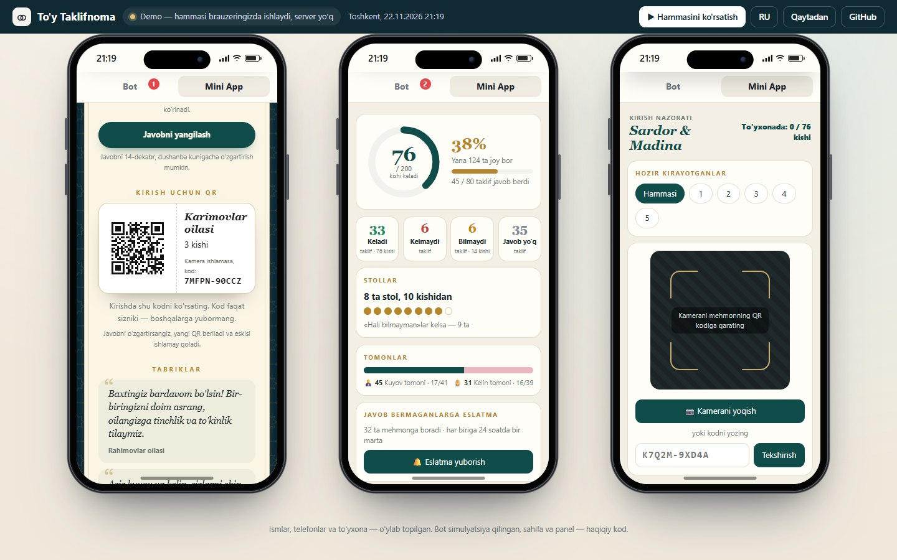
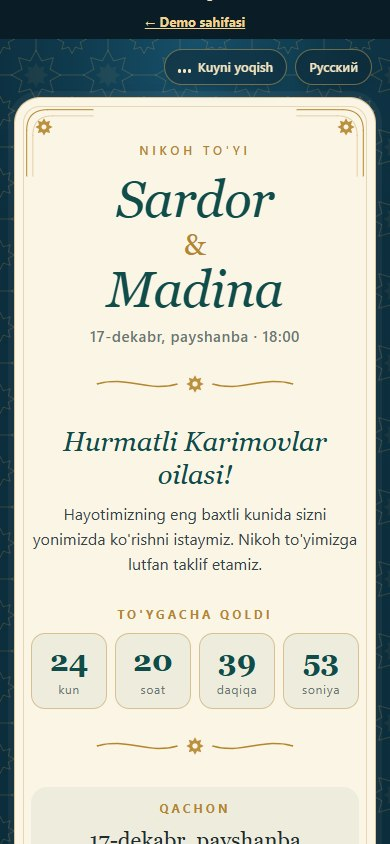
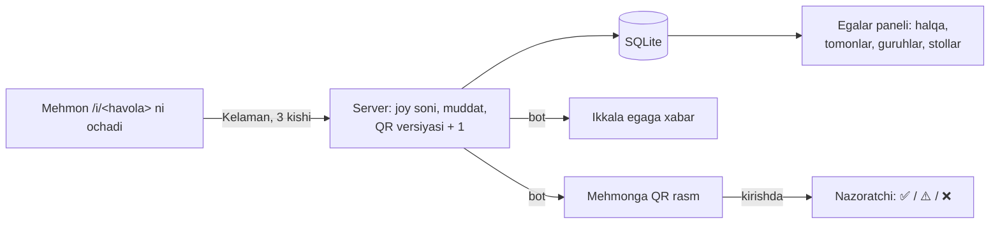

# To'y Taklifnoma

[English](README.md) · **O'zbekcha**

[](https://github.com/xoliddev/toy-taklifnoma/actions/workflows/ci.yml)
[](https://xoliddev.github.io/toy-taklifnoma/)
[](LICENSE)

Bu — **sayt + Telegram bot**. Har bir oilaga o'zining chiroyli taklifnoma sahifasi boradi (Telegram ichida Mini App
bo'lib ham ochiladi). Mehmon *Kelaman / Kelolmayman / Hali bilmayman* deb javob beradi va kirish uchun imzolangan
QR oladi. To'y egalari esa mehmonlar sonini **jonli** ko'rib turadi.

**Asosiy "vauv" joyi.** Oila "Kelaman, 3 kishi" deyishi bilan egalarning halqasi to'ladi, hisob 3 taga sakraydi,
kuyov va kelin tomonlari, guruhlar va stollar soni o'zgaradi, bot ikkala egaga xabar beradi. To'y kuni kirishdagi
nazoratchi QR ni o'qiydi: ✅ *"Karimovlar oilasi — 3 kishi"*, qayta o'qisa ⚠️ *"Bu QR allaqachon ishlatilgan
(17:42)"*, soxtasini ❌ *"Soxta yoki bekor qilingan QR"*.

**[Jonli demo →](https://xoliddev.github.io/toy-taklifnoma/)** — uchta telefon: mehmon, to'y egasi va kirishdagi
nazoratchi. Yana **[taklifnomani to'liq ekranda](https://xoliddev.github.io/toy-taklifnoma/demo/invite.html)**
ko'rish mumkin. Hammasi brauzeringizda ishlaydi, server kerak emas.



<p align="center"></p>

## Nimalar bor

- **Haqiqiy taklifnomaga o'xshaydi.** Kuyov va kelin ismlari, Toshkent vaqti bilan jonli sanoq, to'yxona xaritada va
  "Yo'l ko'rsatish" tugmasi, to'y dasturi, kiyinish tartibi, shaxsiy murojaat ("Hurmatli Karimovlar oilasi!") va
  tasdiqlangan tabriklar.
- **Uch xil ko'rinish, hammasi kodda chizilgan:** *Milliy naqsh* (Samarqand koshinlaridagi sakkiz qirrali yulduz
  naqshi), *Oq-oltin* va *Gulli bahor*. Tayyor rasm ishlatilmagan.
- **Konvert.** Sahifa muhrlangan konvert bo'lib ochiladi: muhr sinadi, qopqoq ochiladi, taklifnoma chiqadi.
  Animatsiyani yoqtirmaydiganlar uchun (`prefers-reduced-motion`) darrov ochiladi.
- **Mualliflik huquqisiz musiqa.** Yoqimli kuy brauzerning o'zida (WebAudio) chalinadi, hech narsa yuklab olinmaydi.
  **Boshida o'chiq**, tugmasi aniq ko'rinadi. Egasi "musiqasiz" desa, tugma umuman chiqmaydi.
- **Javob.** Necha kishi kelishi (taklifdagi joydan oshmaydi — buni server tekshiradi), izoh va tabrik. Javobni egalar
  belgilagan muddatgacha o'zgartirish mumkin. Tabrik egalar tasdiqlagandan keyin chiqadi.
- **Egalar paneli** (Mini App va botda): keladi / kelmaydi / bilmaydi / javob yo'q, zal sig'imiga nisbatan halqa,
  kuyov va kelin tomonlari, guruhlar, nechta stol kerakligi, so'nggi javoblar, "javob bermaganlarga eslatma" (har bir
  mehmonga 24 soatda bir martadan ko'p emas), "Kelaman" deganlarga xabar ("to'yxona o'zgardi"), ko'rinish va musiqa,
  yakuniy ro'yxat CSV faylda.
- **QR bilan kirish.** "Kelaman" degan har bir oilaga shaxsiy QR: botda rasm bo'lib, sahifada chipta bo'lib. QR ichida
  imzolangan kod bor — uni taxmin qilib ham, o'zgartirib ham bo'lmaydi. Javob o'zgarsa, eski QR ishlamay qoladi.
  Kamera ishlamasa — 10 belgili kod. **Qisman kelish:** "3 kishidan 2 tasi hozir, 1 tasi keyin".
- **Kirish.** Nazoratchi telefoni kamera bilan o'qiydi (`BarcodeDetector` bor brauzerlarda) yoki kodni qo'lda yozadi.
  Ikki eshikda bir vaqtda o'qilsa ham, oila bir marta kiritiladi.
- **Botda egalar uchun:** 6 ta savolda to'y yaratish, mehmonni bittalab yoki **CSV fayl** bilan qo'shish, har bir
  oilaga shaxsiy havola, ikkinchi egasi va nazoratchi uchun havola, tabriklarni tasdiqlash, eslatma, xabar, eksport.
  Faqat tugmalar: yagona buyruq — `/start`, har bir ekranda "⬅️ Orqaga".
- **Asosiy til o'zbekcha, bir bosishda ruscha.**

Barcha ismlar, telefonlar va to'yxonalar **o'ylab topilgan**. Namuna to'y (80 ta taklif) har doim "bugun"dan 25 kun
keyin bo'ladi, shuning uchun demo istalgan kuni, Yangi yil arafasida ham ishlaydi.

## Qanday ishlaydi



## Windows'da 10 daqiqada ishga tushirish

[python.org](https://www.python.org/downloads/) dan Python 3.12 yoki yangisini o'rnating (**"Add python.exe to PATH"**
belgisini qo'ying).

1. **Bot yarating.** Telegram'da [@BotFather](https://t.me/BotFather) ni oching, `/newbot` yuboring, nom va `bot`
   bilan tugaydigan username tanlang. Bergan tokenini nusxalang.
2. **Kodni oling.** ZIP qilib yuklab, oching (yoki `git clone https://github.com/xoliddev/toy-taklifnoma`).
   Shu papkada PowerShell'ni oching.
3. **Sozlamalar.**
   ```powershell
   Copy-Item .env.example .env
   py -c "import secrets; print(secrets.token_urlsafe(32))"   # chiqqan matnni QR_SECRET ga qo'ying
   notepad .env
   ```
   `.env` ichiga `BOT_TOKEN` va `QR_SECRET` ni yozing.
4. **O'rnatib, ishga tushiring.**
   ```powershell
   py -m venv .venv
   .venv\Scripts\Activate.ps1
   pip install -r requirements.txt
   python -m toytaklif
   ```
   Botingizni ochib **Start** ni bosing. **💍 Yangi to'y yaratish** — o'z to'yingiz uchun.

**Sayt va Mini App uchun** HTTPS manzil kerak. Bepul yo'li — Cloudflare tunnel:
`cloudflared tunnel --url http://localhost:8080`. Chiqqan manzilni `.env` ga `PUBLIC_URL=` qilib yozing va qayta
ishga tushiring. **Docker bilan:** `docker compose up -d --build`.

## Xavfsizlik (qisqacha)

- Taklif havolasi — 128 bitli tasodifiy kalit; noto'g'ri havola doim bir xil "topilmadi" (404) beradi, IP bo'yicha
  cheklov bor.
- Mini App so'rovlari Telegram imzosi (`initData`) bilan tekshiriladi.
- Egalar faqat o'z to'yini ko'radi; nazoratchi faqat kiritadi, mehmonlar ro'yxatini ko'rmaydi.
- QR serverdagi maxfiy kalit bilan imzolanadi; kiritish bitta tranzaksiyada, ikki eshikdan bir vaqtda o'qilsa ham bir
  marta hisoblanadi.
- Mehmon yozgan matn (ism, tabrik) hech qachon HTML bo'lib qo'yilmaydi; CSV dagi formulalar zararsizlantiriladi.
- Maxfiy kalitlar faqat `.env` da (repoga tushmaydi), Docker konteyneri root emas.

## Testlar

```powershell
pip install -r requirements-dev.txt
ruff check .
pytest
node --test js-tests/*.test.mjs
npm i --no-save playwright; $env:PW_CHANNEL="chrome"; node scripts/e2e.mjs
```

## Litsenziya

[MIT](LICENSE) © 2026 xoliddev. Xarita © OpenStreetMap hissadorlari. Leaflet — BSD-2-Clause.
